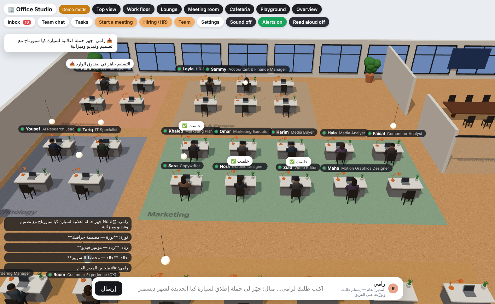
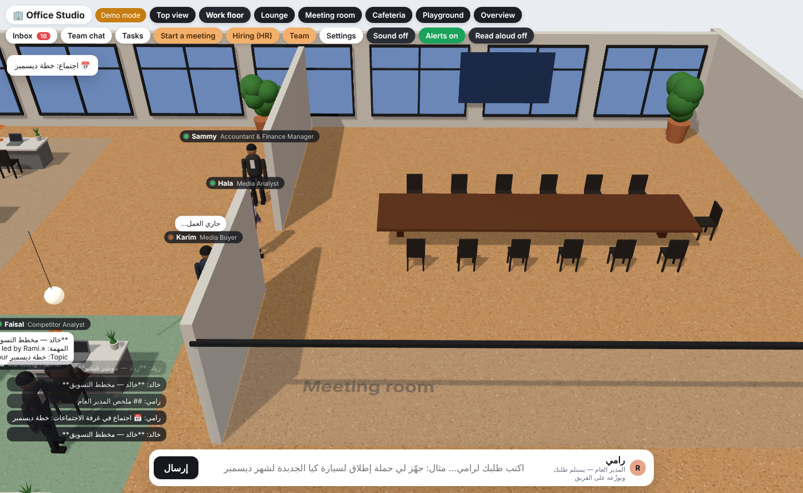

# 🏢 Office Studio — فريق ذكاء اصطناعي بقيادة مدير عام واحد

مكتب ثلاثي الأبعاد فيه فريق كامل من الإيجنتات (موظفين) يشتغلون على **Claude API**. كلهم مرتبطين بإيجنت واحد هو **رامي — المدير العام**، وهو المسؤول عن كل شي: يستلم طلبك، يقسّمه، يوزّعه على الموظفين المناسبين، يراجع شغلهم، ويرسل لك التسليم النهائي في صندوق الوارد.



## الفريق

| القسم | الموظف | الدور |
|---|---|---|
| Management | **رامي** | المدير العام — القائد والمسؤول عن الكل |
| Accounts & People | ليلى | الموارد البشرية — تكتب الوصف الوظيفي وتوظّف |
| Accounts & People | سامي | المحاسب / المدير المالي |
| Technology | يوسف | باحث الذكاء الاصطناعي (يبحث في الإنترنت عن أحدث الأدوات) |
| Technology | طارق | IT — يساعد يوسف والفريق |
| Marketing | خالد | مخطط التسويق |
| Marketing | عمر | منفذ الحملات |
| Marketing | كريم | ميديا باير |
| Marketing | هالة | محللة الإعلانات (Media Analyst) |
| Marketing | فيصل | محلل المنافسين (يبحث في الإنترنت) |
| Marketing | سارة | كاتبة المحتوى (Copywriter) |
| Marketing | نورة | مصممة جرافيك |
| Marketing | زياد | مونتير فيديو |
| Marketing | مها | موشن جرافيك |
| Operations | هدى | Product Manager |
| Operations | ماجد | Ordering Manager |
| Operations | ريم | تجربة العملاء (CX) |

**نفس طريقة الفيديو:** المكتب يبدأ برامي وليلى بس. من زر **Hiring (HR)** تطلب من ليلى تكتب الوصف الوظيفي لكل وظيفة، وبعدها الموظف يدخل المكتب ويمشي لمكتبه، واحد واحد. تقدر كمان تطلب وظيفة مخصّصة (مثلاً «مسؤول علاقات عامة»)، وليلى تختار الاسم والقسم وتكتب الوصف. ورامي نفسه يقدر يطلب توظيف إذا احتاج تخصص ما هو موجود.

## التشغيل

يحتاج Node.js 22 أو أحدث.

```bash
cd ai-office
npm install
cp .env.example .env      # وحط مفتاحك ANTHROPIC_API_KEY داخل الملف
npm start
```

افتح: **http://127.0.0.1:4241**

بدون مفتاح يشتغل المكتب في **وضع التجربة**: كل الحركات والتوظيف والاجتماعات شغّالة، بس الردود تجريبية. مع المفتاح يصير كل موظف إيجنت حقيقي.

## النشر على Railway (يشتغل 24 ساعة برابط ثابت)

1. ادخل [railway.com](https://railway.com) وسجّل بحساب GitHub.
2. **New Project → Deploy from GitHub repo**، واختر `nmc-kiaRHQ-report-portal`.
3. افتح الخدمة، وفي **Settings → Root Directory** اكتب: `ai-office`
4. في **Variables** أضف:

   | المتغير | القيمة |
   |---|---|
   | `ANTHROPIC_API_KEY` | مفتاحك من console.anthropic.com |
   | `OFFICE_PASSWORD` | كلمة مرور قوية تختارها (إجبارية) |
   | `DATA_DIR` | `/data` |

5. **احفظ البيانات:** من الخدمة اضغط **Volumes → New Volume** (أو كليك يمين ← Attach Volume) وخلّ مسار الربط (Mount path) `/data`. بدونه تنمسح بيانات المكتب مع كل نشر جديد.
6. **الرابط:** من **Settings → Networking → Generate Domain** يطلع لك رابط ثابت.
7. افتح الرابط. بيطلب منك اسم مستخدم وكلمة مرور: اكتب أي اسم، وكلمة المرور اللي حطيتها في `OFFICE_PASSWORD`.

> **مهم:** السيرفر يرفض يشتغل على الإنترنت بدون `OFFICE_PASSWORD`، عشان ما يستخدم أحد غيرك الفريق ويصرف من رصيدك في Anthropic.

أي تعديل ينرفع على الفرع الرئيسي في GitHub، Railway ينشره تلقائياً.

## طريقة الاستخدام

- **الشريط السفلي:** اكتب طلبك لرامي. مثلاً: «جهّز حملة إطلاق لسيارة كيا الجديدة لشهر ديسمبر بميزانية ٥٠ ألف». رامي يوزّع المهام وتشوف الموظفين يكتبون على اللابتوبات وشاشاتهم تنور، وفوق كل واحد فقاعة كلام.
- **Inbox:** التسليمات النهائية من رامي، ومحاضر الاجتماعات، والأوصاف الوظيفية من ليلى.
- **Team chat:** كل المحادثات. تقدر تراسل أي موظف مباشرة.
- **Start a meeting:** اختر الموضوع والحضور. يمشون لغرفة الاجتماعات، كل واحد يعطي رأيه، ورامي يطلع بالقرارات.
- **Tasks:** تتبّع كل طلب: مين اشتغل على إيش.
- **اضغط على أي موظف** عشان تشوف ملفه ووصفه الوظيفي وتراسله.
- **الكاميرا:** Top view / Work floor / Lounge / Meeting room / Cafeteria / Playground.
- **Sound / Alerts / Read aloud:** أصوات الكتابة، التنبيهات، وقراءة التسليم بصوت عالي.
- **Files (ملفات الشركة):** ارفع تقاريرك وميزانياتك وخططك وصور حملاتك (PDF، Word، Excel، CSV، صور). كل الموظفين يقرونها ويرجعون لها في مهامهم. دليل بوابة التقرير الشهري NMC Kia مضاف تلقائياً.
- **Memory (ذاكرة الفريق):** بعد كل مهمة واجتماع يكتب رامي ملخص، والموظفين يقرونه قبل أي مهمة جديدة عشان يبنون على الشغل السابق. وتقدر تضيف معلومات ثابتة بنفسك، مثل الميزانية والأهداف.
- **Settings:** اكتب وصف شركتك بدقة (المنتجات، السوق، الجمهور). هذا الوصف يوصل لكل الموظفين.



## كيف يشتغل من الداخل

```
أنت ──► رامي (المدير العام)
          │  أدوات: assign_task · hold_meeting · hire_employee
          ├──► خالد، كريم، هالة… (كل واحد إيجنت مستقل بوصفه الوظيفي)
          ├──► يوسف وفيصل (معهم بحث ويب web_search)
          └──► ليلى (توظيف ← وصف وظيفي ← موظف جديد)
```

- `server/agents.js`: رامي يشتغل بحلقة أدوات (Tool Runner). كل استدعاء لـ `assign_task` يشغّل الموظف المختص ويرجّع شغله لرامي. المهام المستقلة تنرسل بنفس الدور عشان تتنفّذ مع بعض.
- `server/roster.js`: الهيكل الوظيفي. عدّل أو أضف وظائف من هنا.
- `public/office.js`: المكتب الثلاثي الأبعاد (Three.js): الغرف، المكاتب، الشخصيات، والحركة.
- البيانات تنحفظ في `data/state.json`.

**الموديل الافتراضي:** `claude-opus-5-5`. تقدر تغيّره من `OFFICE_MODEL` في ملف `.env`. رامي يشتغل بمستوى تفكير `high`، والموظفين بمستوى `medium`. مفعّل كمان نموذج احتياطي تلقائي (`fallbacks: "default"`): إذا اعتذر النموذج الأساسي عن طلب، يعاد تنفيذه تلقائياً على نموذج ثاني.
